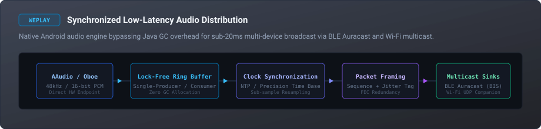
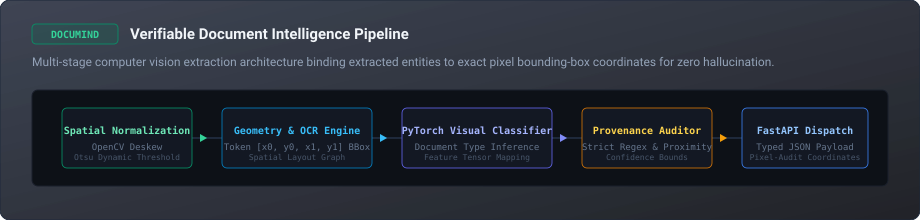
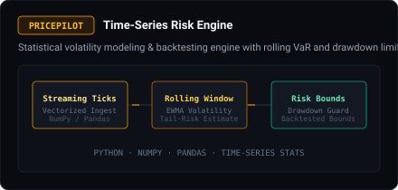
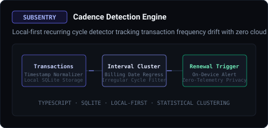

  

 

  <a href="mailto:suryaflame2007@gmail.com"><strong>Email</strong></a>&nbsp;&nbsp;&nbsp;·&nbsp;&nbsp;&nbsp;
  <a href="https://www.linkedin.com/in/surya-narayanan-157976396/"><strong>LinkedIn</strong></a>&nbsp;&nbsp;&nbsp;·&nbsp;&nbsp;&nbsp;
  <a href="https://github.com/Suryaflame5?tab=repositories"><strong>Repositories</strong></a>&nbsp;&nbsp;&nbsp;·&nbsp;&nbsp;&nbsp;
  Chennai, India

 

  

### Overview

I build low-latency systems software, native Android audio engines, and practical computer vision pipelines.

Most of my work sits at the intersection between software and hardware constraints—handling network packet jitter, audio buffer under-runs, clock drift between unsynchronized devices, and extracting verifiable structured data from noisy scanned documents.

---

### Selected Engineering Work

#### 01 / WePlay — Universal Synchronized Audio Sharing
> **Repository:** [github.com/Suryaflame5/WePlay](https://github.com/Suryaflame5/WePlay)  
> **Core Stack:** Kotlin, Android NDK, C++, AAudio / Oboe, Bluetooth LE Audio (Auracast), Wi-Fi Multicast (UDP)

  

* **Problem:** Android's default Java audio path introduces variable latency (often 40ms+) and unpredictable garbage collection pauses, making synchronized multi-device playback drift out of phase within seconds.
* **Engineering Solution:**
  * Bypassed the Java audio server using the **Android NDK** and native `AAudio` / `Oboe` bindings to stream raw 48 kHz / 16-bit PCM samples through a custom lock-free circular ring buffer.
  * Implemented linear regression clock drift estimation to align remote playback clocks within sub-millisecond tolerances.
  * Packaged audio frames into sequenced UDP multicast packets with forward error correction (FEC) for simultaneous Wi-Fi and Bluetooth LE Audio (Auracast Broadcast Isochronous Streams) distribution.

 

#### 02 / DocuMind — Traceable Document Intelligence
> **Repository:** [github.com/Suryaflame5/documind](https://github.com/Suryaflame5/documind)  
> **Core Stack:** Python, PyTorch, OpenCV, Scikit-Learn, FastAPI, Docker

  

* **Problem:** Commercial LLM-based document parsers are prone to hallucinating numerical fields, invoice IDs, and critical metadata when dealing with skewed, low-resolution, or non-standard scanned documents.
* **Engineering Solution:**
  * Created a deterministic multi-stage vision pipeline that normalizes incoming scans via OpenCV deskewing and Otsu thresholding before spatial OCR token extraction.
  * Built a hybrid PyTorch visual-textual classification model that recognizes document layouts without relying on generative LLMs.
  * Enforced **100% pixel provenance**: every extracted key-value entity maps directly to its `[x0, y0, x1, y1]` bounding-box coordinates on the original source scan, providing a verifiable audit trail for downstream APIs.

 

#### 03 / Specialized Systems

  <table border="0" cellspacing="12" cellpadding="0" width="100%">
    <tr>
      <td width="50%" align="center">
        
      </td>
      <td width="50%" align="center">
        
      </td>
    </tr>
  </table>

* **[PricePilot](https://github.com/Suryaflame5/pricepilot)**: Vectorized financial time-series risk engine written in Python (NumPy, pandas). Computes rolling exponentially weighted moving average (EWMA) volatility windows and value-at-risk (VaR) drawdown boundaries for backtested strategies.
* **[SubSentry](https://github.com/Suryaflame5/SubSentry)**: Local-first subscription cadence detector built with TypeScript and SQLite. Analyzes irregular transaction interval clusters to detect recurring billing cycles without transmitting financial data to external cloud servers.

---

### Technical Focus & Tooling

| Domain | Technologies & Systems | Focus Areas |
| :--- | :--- | :--- |
| **Languages & Runtimes** | `C++`, `Kotlin`, `Python`, `TypeScript`, `SQL` | Lock-free structures, native interop (JNI/NDK), asynchronous I/O |
| **Systems & Audio** | `Android NDK`, `AAudio / Oboe`, `WebSockets`, `UDP Multicast`, `Bluetooth LE Audio` | Jitter buffering, clock synchronization, sub-20ms audio latency |
| **Machine Learning & Vision** | `PyTorch`, `OpenCV`, `Scikit-Learn`, `FastAPI`, `Tesseract` | Layout analysis, token spatial graphs, deterministic field extraction |
| **Infrastructure & Data** | `Docker`, `PostgreSQL`, `SQLite`, `Git`, `Linux (Debian/Ubuntu)` | Zero-copy pipelines, local-first schemas, containerized reproducible builds |

---

### Working Principles

* **Start with simple baselines:** Measure a simple heuristic or statistical model before introducing deep networks or distributed complexity.
* **Verifiable outputs:** In production systems, knowing *where* data came from (pixel coordinates, packet sequence numbers) matters as much as the value itself.
* **Degrade gracefully:** Audio packets will drop, network latency will spike, and document scans will be blurred. Systems should recover cleanly without unhandled panics or memory leaks.

 

  
  
P. Suryanarayanan · Chennai, India · <a href="mailto:suryaflame2007@gmail.com">suryaflame2007@gmail.com</a>

