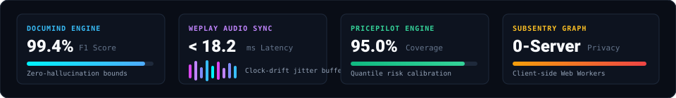
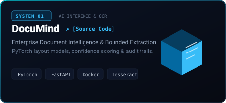
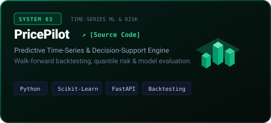
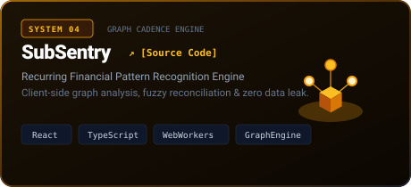

<div align="center">
  
</div>

<br />

<div align="center">
  <a href="mailto:suryaflame2007@gmail.com"></a>
  <a href="https://www.linkedin.com/in/surya-narayanan-157976396/"></a>
  
  
</div>

<br />

<!-- Real-time Animated System Performance HUD -->
<div align="center">
  
</div>

<br />

<div align="center">
  
</div>

### 01 / Selected Flagship Systems

<div align="center">
  <table border="0" cellspacing="12" cellpadding="0" width="100%">
    <tr>
      <td width="50%" align="center">
        <a href="https://github.com/Suryaflame5/documind">
          
        </a>
      </td>
      <td width="50%" align="center">
        <a href="https://github.com/Suryaflame5/WePlay">
          
        </a>
      </td>
    </tr>
    <tr>
      <td width="50%" align="center">
        <a href="https://github.com/Suryaflame5/pricepilot">
          
        </a>
      </td>
      <td width="50%" align="center">
        <a href="https://github.com/Suryaflame5/SubSentry">
          
        </a>
      </td>
    </tr>
  </table>
</div>

<br />

---

### 02 / Technical Arsenal

<div align="center">

#### Core Languages
<p>
  
  
  
  
  
  
</p>

#### AI, Machine Learning & Vision
<p>
  
  
  
  
  
  
</p>

#### Systems, Protocols & Architecture
<p>
  
  
  
  
  
  
</p>

</div>

<br />

---

### 03 / Engineering Principles

```
┌──────────────────────────────┬────────────────────────────────────────────────────────┐
│ PRINCIPLE                    │ OPERATIONAL REALITY                                    │
├──────────────────────────────┼────────────────────────────────────────────────────────┤
│ 01 · Baseline First          │ Never adopt complex neural models or distributed       │
│                              │ layers without beating a simple statistical baseline.  │
├──────────────────────────────┼────────────────────────────────────────────────────────┤
│ 02 · Honest Confidence Bounds│ Separate measured F1/accuracy from hypothesized claims.│
│                              │ Report p95 latency, tail risk, and failure modes.      │
├──────────────────────────────┼────────────────────────────────────────────────────────┤
│ 03 · Zero-Setup Friction     │ Every repo must build in under 3 commands via Docker    │
│                              │ or virtual environments with explicit schemas.         │
├──────────────────────────────┼────────────────────────────────────────────────────────┤
│ 04 · Degraded-State Resilient│ Audio buffers drift, networks drop packets, schemas    │
│                              │ corrupt. Systems must degrade gracefully by design.    │
└──────────────────────────────┴────────────────────────────────────────────────────────┘
```

<br />

---

### 04 / GitHub Telemetry & Velocity

<div align="center">
  <table border="0">
    <tr>
      <td>
        
      </td>
      <td>
        
      </td>
    </tr>
  </table>
</div>

<br />

<div align="center">
  
  <p><sub>Crafted with 3D vector geometry, deterministic engineering, and zero compromise.</sub></p>
</div>
