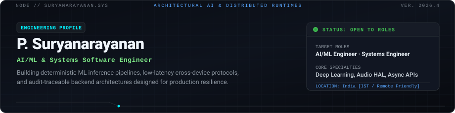

<div align="center">
  
</div>

<p align="center">
  <a href="#flagship-systems"><strong>01 / FLAGSHIP SYSTEMS</strong></a>&nbsp;&nbsp;·&nbsp;&nbsp;
  <a href="#technical-arsenal"><strong>02 / TECHNICAL ARSENAL</strong></a>&nbsp;&nbsp;·&nbsp;&nbsp;
  <a href="#engineering-standards"><strong>03 / ENGINEERING PRINCIPLES</strong></a>&nbsp;&nbsp;·&nbsp;&nbsp;
  <a href="#contact"><strong>04 / CONTACT</strong></a>
</p>

<div align="center">
  
</div>

### 00 / Core Focus

I design and build **production-grade AI inference pipelines**, **low-latency mobile/systems software**, and **deterministic backend architectures**.

* **What I care about:** Systems that work after the demo—handling degraded network states, messy unstructured inputs, strict latency budgets, and verifiable metrics.
* **Architecture over hype:** Separating measured system performance from marketing claims. Prioritizing reproducible benchmarks, explicit schemas, and clean error recovery over unprincipled complexity.

<br />

---

### <a id="flagship-systems"></a>01 / Flagship Systems

```
┌────────────────────────────────────────────────────────────────────────────────────────┐
│ [01] DocuMind — Enterprise Document Intelligence & Field Extraction System             │
│ PyTorch · Scikit-Learn · FastAPI · Tesseract OCR · Docker · Python                     │
└────────────────────────────────────────────────────────────────────────────────────────┘
```
> **Repository:** [github.com/Suryaflame5/documind](https://github.com/Suryaflame5/documind)
* **Architecture:** Multi-stage extraction pipeline combining document layout analysis, PyTorch visual feature classification, and rule-bounded entity recognition.
* **Engineering Challenge:** Eliminating hallucination risks in automated document parsing by establishing deterministic confidence intervals and verifiable audit trails for every extracted field.
* **Key Capabilities:**
  * Sub-second multi-page document classification across diverse scanned document formats.
  * Traceable bounding-box coordinate mapping linking raw image pixels to API payload outputs.
  * Asynchronous batch worker queue designed for horizontal container scaling.

```
┌────────────────────────────────────────────────────────────────────────────────────────┐
│ [02] WePlay — Universal Audio Sharing & Low-Latency Sync Protocol                      │
│ Android · Kotlin · Audio HAL / NDK · WebSockets · Coroutines · Wi-Fi P2P              │
└────────────────────────────────────────────────────────────────────────────────────────┘
```
> **Repository:** [github.com/Suryaflame5/WePlay](https://github.com/Suryaflame5/WePlay)
* **Architecture:** Distributed companion audio streaming platform utilizing Bluetooth Auracast broadcasts alongside companion high-bandwidth local Wi-Fi multicast channels.
* **Engineering Challenge:** Maintaining synchronized sub-20ms multi-device audio playback across varying Android hardware revisions without audio buffer underruns or clock drift.
* **Key Capabilities:**
  * Real-time master-clock synchronization algorithm with adaptive jitter-buffer compensation.
  * Low-level Android AudioRecord / AudioTrack integration via native NDK bindings.
  * Zero-configuration peer discovery over local LAN subnets without external internet dependency.

```
┌────────────────────────────────────────────────────────────────────────────────────────┐
│ [03] PricePilot — Time-Series Forecasting & Uncertainty Decision Engine               │
│ Python · Time-Series ML · Quantile Regression · Pandas · FastAPI                       │
└────────────────────────────────────────────────────────────────────────────────────────┘
```
> **Repository:** [github.com/Suryaflame5/pricepilot](https://github.com/Suryaflame5/pricepilot)
* **Architecture:** Statistical decision-support engine comparing predictive models on structured historical data with explicit uncertainty estimation bounds.
* **Engineering Challenge:** Preventing lookahead data leakage in walk-forward backtesting pipelines and surfacing prediction intervals rather than deceptive single-point forecasts.
* **Key Capabilities:**
  * Rigorous out-of-sample backtesting framework with automated model degradation detection.
  * Uncertainty-aware risk bounds quantifying prediction confidence during market volatility.
  * Fast REST API providing interactive model comparison and historical error diagnostics.

```
┌────────────────────────────────────────────────────────────────────────────────────────┐
│ [04] SubSentry — Recurring Transaction Pattern Analysis Engine                         │
│ React · TypeScript · Graph Analysis · Web Workers · Financial Data Schemas             │
└────────────────────────────────────────────────────────────────────────────────────────┘
```
> **Repository:** [github.com/Suryaflame5/SubSentry](https://github.com/Suryaflame5/SubSentry)
* **Architecture:** Client-side financial intelligence system analyzing raw statement exports to detect recurring payment obligations and anomalous cost surges.
* **Engineering Challenge:** Reconciling irregular billing cadences and inconsistent merchant descriptors without exposing raw user transaction data to remote servers.
* **Key Capabilities:**
  * 100% private in-browser analysis executed inside Web Workers with zero server data retention.
  * Interval-consistency scoring engine identifying weekly, monthly, and seasonal billing cycles.
  * Explainable evidence breakdown showing the exact transaction matches behind every flag.

<br />

---

### <a id="technical-arsenal"></a>02 / Technical Arsenal

| Systems Layer | Stack & Tooling | Focus & Applications |
| :--- | :--- | :--- |
| **Languages** | `Python`, `TypeScript`, `Kotlin`, `JavaScript`, `SQL`, `C/C++` | Production backend, native Android, and data pipelines |
| **Machine Learning & Vision** | `PyTorch`, `Scikit-Learn`, `OpenCV`, `Hugging Face`, `Ollama` | Document intelligence, classification, edge CV, local LLM runtimes |
| **API & Backend Systems** | `FastAPI`, `Node.js`, `REST APIs`, `WebSockets`, `Asynchronous IO` | Low-latency streaming, event-driven architectures, scalable microservices |
| **Client & Mobile Engineering**| `Android Native (Kotlin)`, `React`, `React Native / Expo`, `Tailwind CSS` | Device lockdown, audio streaming, responsive performance-critical web UIs |
| **Infrastructure & Database** | `Docker`, `Git`, `PostgreSQL`, `Supabase`, `Linux Environments` | Containerized deployments, relational schemas, automated CI/CD workflows |

<br />

---

### <a id="engineering-standards"></a>03 / Engineering Principles

* **Complexity Must Earn Its Place:** Every architecture starts with the simplest working baseline. Additional layers, microservices, or complex neural models must show measurable improvements on controlled evaluation benchmarks before adoption.
* **Evidence Before Claims:** Clear reporting of edge cases, latency percentiles (p50/p95/p99), and known failure modes alongside successful tests.
* **Inspectable & Reproducible:** Complete setup automation, explicit environmental configurations, and clean documentation so any engineer can reproduce results locally within minutes.
* **Failure-Tolerant by Default:** Network degradation, malformed payloads, schema drift, and timeouts are treated as first-class citizens in system design, not afterthoughts.

<br />

---

### <a id="contact"></a>04 / Contact & Collaboration

* **Direct Email:** [suryaflame2007@gmail.com](mailto:suryaflame2007@gmail.com)
* **LinkedIn:** [linkedin.com/in/surya-narayanan-157976396](https://www.linkedin.com/in/surya-narayanan-157976396/)
* **All Public Code:** [github.com/Suryaflame5?tab=repositories](https://github.com/Suryaflame5?tab=repositories)

<div align="center">
  
  <p><sub>Architected with precision. Engineered for reliability.</sub></p>
</div>
